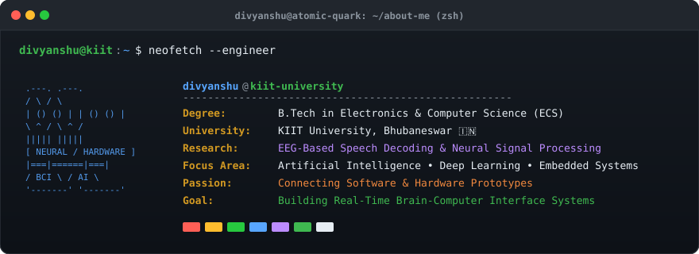
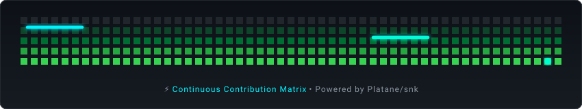

<div align="center">

  <!-- ==================== ANIMATED HEADER BANNER ==================== -->
  

  <br />

  <!-- ==================== ANIMATED TYPING SECTION ==================== -->
  

  <br />

  

</div>

<br />

<!-- ==================== ABOUT ME TERMINAL ==================== -->
<div align="center">
  
</div>

<br />

<div align="center">
  
</div>

<br />

<!-- ==================== RESEARCH & INTERESTS ==================== -->
### 🔬 Research & Engineering Focus

```text
┌───────────────────────────┬───────────────────────────┬───────────────────────────┐
│  🧠 Neural Signal ML      │  ⚡ Embedded IoT Systems   │  🌐 Scalable Full-Stack   │
├───────────────────────────┼───────────────────────────┼───────────────────────────┤
│ • EEG Speech Decoding     │ • Hardware-Software Bridge│ • High-Throughput APIs    │
│ • Biometric Transformers  │ • Microcontroller Firmware│ • Modern Reactive UIs     │
│ • Biosignal Filtering     │ • Sensor Telemetry        │ • Vector / NoSQL Stores   │
└───────────────────────────┴───────────────────────────┴───────────────────────────┘
```

<br />

<div align="center">
  
</div>

<br />

<!-- ==================== TECHNICAL STACK ==================== -->
### 🛠️ Technical Stack & Tooling

#### 💻 Programming Languages
<p align="left">
  
  
  
  
  
</p>

#### 🧠 Artificial Intelligence & Machine Learning
<p align="left">
  
  
  
  
  
</p>

#### 🎨 Frontend Engineering
<p align="left">
  
  
  
  
</p>

#### ⚙️ Backend, Systems & APIs
<p align="left">
  
  
  
</p>

#### 🗄️ Databases & Vector Stores
<p align="left">
  
  
</p>

#### 🔌 Electronics & Hardware Systems
<p align="left">
  
  
  
</p>

#### 🚀 DevOps & Tooling
<p align="left">
  
  
  
  
</p>

<br />

<div align="center">
  
</div>

<br />

<!-- ==================== GITHUB ANALYTICS & SNAKE ==================== -->
### 📊 GitHub Activity & Real-Time Analytics

<div align="center">

  <!-- Contribution Snake Animation -->
  <picture>
    <source media="(prefers-color-scheme: dark)" srcset="https://raw.githubusercontent.com/Atomic-Quark/Atomic-Quark/output/github-contribution-grid-snake-dark.svg">
    <source media="(prefers-color-scheme: light)" srcset="https://raw.githubusercontent.com/Atomic-Quark/Atomic-Quark/output/github-contribution-grid-snake.svg">
    
  </picture>

  <br /><br />

  <!-- GitHub Dynamic Analytics Cards -->
  <a href="https://github.com/Atomic-Quark">
    
  </a>
  <a href="https://github.com/Atomic-Quark">
    
  </a>

  <br />

  <a href="https://github.com/Atomic-Quark">
    
  </a>

</div>

<br />

<div align="center">
  
</div>

<br />

<!-- ==================== CONNECT & STATUS ==================== -->
### 📬 Connect & Collaborate

<p align="left">
  <a href="mailto:atom.network45@gmail.com">
    
  </a>
  <a href="https://github.com/Atomic-Quark">
    
  </a>
  <a href="https://linkedin.com/in/YOUR_LINKEDIN_USERNAME">
    
  </a>
</p>

<br />

<!-- ==================== ANIMATED FOOTER ==================== -->
<div align="center">
  
</div>
